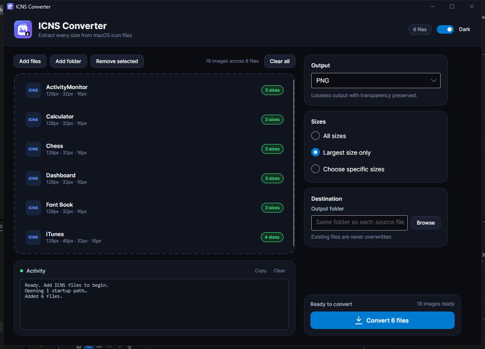
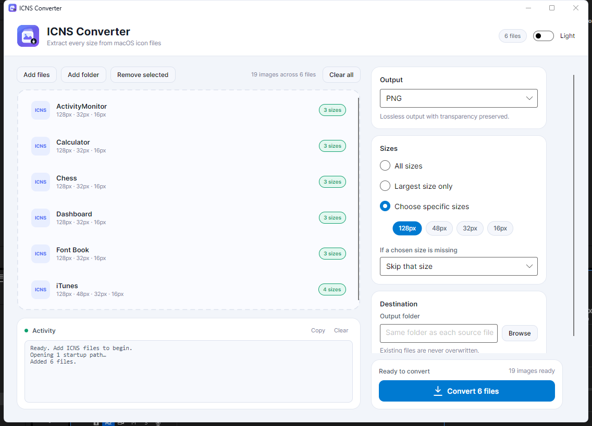

# ICNS Converter

A desktop app that extracts every image size from macOS `.icns` icon files.

Built with Avalonia and .NET 10. It handles modern PNG / JPEG 2000 icons as well as the legacy 16/32/48/128 px formats used by older macOS releases.

<p align="center">
  
  
</p>

## Download

Compiled builds are published through [GitHub Releases](../../releases/latest). This repository contains **source only**.

Release assets include:

- `IcnsConverter-1.0.0-win-x64-setup.exe` — installer for Windows x64
- `IcnsConverter-1.0.0-win-arm64-setup.exe` — installer for Windows 11 ARM64
- A portable build (exe plus its native DLLs) and/or zip
- `SHA256SUMS.txt` — checksums for the release files

### Installer

The installer installs to:

```text
C:\Users\<your user name>\AppData\Local\Programs\IcnsConverter or
C:\Program Files\IcnsConverter for all users
you can change it.
```

It creates a Start Menu shortcut, an optional desktop shortcut, and a standard uninstall entry. The setup also displays the MIT license before installation notes.

### Portable

The portable build can be run directly from its folder without installing.
Keep the native DLLs beside `IcnsConverter.exe`; no .NET installation is
required.

### ARM64

The ARM64 installer is intended for **Windows 11 on ARM64**. As of version 1.0.0 it carries the x64 build, which Windows 11 ARM64 runs through its built-in x64 emulation.

The setup itself currently uses `ArchitecturesAllowed=x64compatible` / `ArchitecturesInstallIn64BitMode=x64compatible` and packages `Magick.Native-Q8-x64.dll`, so it is an x64-emulation package rather than an ARM64-only or native ARM64 build. A true native package requires arm64 install mode, ARM64 native assets, and the .NET 10 ARM64 runtime pack. See [Building a release](#building-a-release).

## Features

- Batch-convert `.icns` files or entire folders
- Extracts all embedded sizes, including legacy icons that ImageMagick alone cannot read
- Outputs PNG, JPG, WEBP, ICO, BMP, TIFF, and GIF
- Multi-size ICO output
- Choose all sizes, largest only, or specific sizes
- Handles missing sizes by skipping, using the largest image, or upscaling
- Never overwrites existing output files — a number is appended instead
- Dark mode by default, with a light/dark switch
- Drag-and-drop, file/folder pickers, and command-line path support
- Self-contained portable build — no .NET installation required; native DLLs ship alongside the exe

## Supported ICNS data

| Family | Chunks |
|---|---|
| Modern PNG / JPEG 2000 | `icp4`–`icp6`, `ic07`–`ic14`, `ic04`, `ic05`, `icsb`, `icsB`, `sb24`, `SB24` |
| Legacy 24-bit RGB + 8-bit mask | `is32`, `il32`, `ih32`, `it32` with `s8mk`, `l8mk`, `h8mk`, `t8mk` |
| Legacy indexed | `ics4`, `ics8`, `icl4`, `icl8`, `ich4`, `ich8` |
| Legacy monochrome | `ICON`, `ICN#`, `ics#`, `ich#` |

The parser also tolerates bad header lengths, missing `it32` headers, and corrupt chunks that require resynchronisation.

## Usage

1. Add individual `.icns` files or a folder.
2. Choose the output format.
3. Select all sizes, the largest size, or specific sizes.
4. Pick an output folder, or leave it empty to write next to each source file.
5. Click **Convert**.

Files can also be opened by passing a path on the command line:

```powershell
IcnsConverter.exe "C:\Icons\MyIcon.icns"
IcnsConverter.exe "C:\Icons"
```

## Build from source

### Requirements

- Windows 10/11
- [.NET 10 SDK](https://dotnet.microsoft.com/)
- Inno Setup 6.7+ (only for building the installers)
- ImageMagick 7 (only for regenerating the icon assets)

> **Recommended checkout location:** `C:\Dev\IcnsConverter`
>
> The Inno Setup `.iss` files currently use absolute paths under
> `C:\Dev\IcnsConverter` for `publish`, `installer`, and `Assets`. Cloning
> the repository there avoids editing those paths when building installers.

### Compile

```powershell
git clone https://github.com/manpiss331-jpg/IcnsConverter.git
cd IcnsConverter
dotnet build -c Release
```

### Portable build (exe + native DLLs)

```powershell
dotnet publish .\IcnsConverter.csproj -c Release -r win-x64 --self-contained true -o .\release\win-x64 -p:PublishSingleFile=true -p:PublishTrimmed=false -p:DebugType=None -p:DebugSymbols=false -p:Version=1.0.0
```

`PublishSingleFile=true` bundles the managed app and the .NET runtime into the exe. The native libraries remain separate, so `release\win-x64` is a portable folder: `IcnsConverter.exe` plus the DLLs it needs. Keep them together when distributing the build. Add `-p:IncludeNativeLibrariesForSelfExtract=true` if you want a true single-file executable instead.

### Installers

Build the x64 installer with:

```powershell
& "C:\Program Files (x86)\Inno Setup 6\ISCC.exe" .\installer\IcnsConverter.iss
```

Build the Arm64 installer with:

```powershell
& "C:\Program Files (x86)\Inno Setup 6\ISCC.exe" .\installer\IcnsConverter-Arm64.iss
```

Requires Inno Setup 6.7+ at the default path, or pass `-Iscc <path>`.

Outputs:

```text
x64: C:\Users\<your user name>\Downloads\IcnsConverter-v1.0.0-win-x64-setup
Arm64: C:\Users\<your user name>\Downloads\IcnsConverter-v1.0.0-win-arm64-setup
```

The Inno Setup script is [installer/IcnsConverter.iss](installer/IcnsConverter.iss), Arm64: [installer/IcnsConverter-Arm64.iss](installer/IcnsConverter-Arm64.iss). Installer content is composed of [LICENSE.rtf](installer/LICENSE.rtf), [INFO-BEFORE.txt](installer/INFO-BEFORE.txt), [INFO-BEFORE-ARM64.txt](installer/INFO-BEFORE-ARM64.txt), and [INFO-AFTER.txt](installer/INFO-AFTER.txt).

### Icons

The app and installer icons are generated from SVG sources:

- App icon: [Assets/app-icon.svg](Assets/app-icon.svg) → `Assets/app.ico`
- Installer icon: [Assets/installer-icon.svg](Assets/installer-icon.svg) → `Assets/installer.ico`

Regenerate them with [Assets/build-icon.ps1](Assets/build-icon.ps1) (requires ImageMagick 7).

## Building a release

1. Run the portable build command above to create the portable folder (exe + native DLLs).
2. Run `& "C:\Program Files (x86)\Inno Setup 6\ISCC.exe" .\installer\IcnsConverter.iss` to create the x64 setup.
3. Run `& "C:\Program Files (x86)\Inno Setup 6\ISCC.exe" .\installer\IcnsConverter-Arm64.iss` to create the Arm64 setup.
4. Create a GitHub Release tagged with the version, for example `v1.0.0`.
5. Attach the portable build (or its zip), both setup files, and the checksum files. If you package the installers as a ZIP, include a short `README.txt` and `SHA256SUMS.txt` alongside them.
6. Do not commit `bin/`, `obj/`, or `release/`; publish those outputs only as release assets.

## Project layout

| Path | Purpose |
|---|---|
| `IcnsReader.cs` | ICNS container parser and legacy image decoders |
| `Exporter.cs` | Output format, resizing, ICO combining, and file naming |
| `MainWindow.axaml` / `.cs` | Main UI and conversion workflow |
| `App.axaml` / `.cs` | Theme resources and application startup |
| `LICENSE` | MIT license |
| `.gitignore` | Excludes generated build output |
| `Assets/` | App and installer icon sources, PNGs, and ICOs |
| `installer/` | Inno Setup script, license, and before/after information pages |
| `docs/` | README screenshots |
| `bin/`, `obj/`, `release/` | Generated during build; not tracked |

## Testing

The ICNS decoder has been validated during development against a 222-file set of Mac OS X 10.4 application icons:

- 222/222 files loaded
- 710 images decoded
- All 710 exported and re-read as valid PNGs
- All output formats tested
- Synthetic tests cover ARGB, monochrome, indexed, headerless `it32`, zero-length headers, corrupt-chunk resynchronisation, PNG chunks, and JPEG 2000

## Known limitations

- The portable build is not a single file: `IcnsConverter.exe` requires the native DLLs shipped beside it.
- The current ARM64 installer is an x64-emulation package: it carries the x64 build, uses x64-compatible install mode, and packages `Magick.Native-Q8-x64.dll`. Native ARM64 packaging requires the .NET 10 ARM64 runtime pack, arm64 install mode, and ARM64 native assets.
- Release executables and installers are unsigned, so Windows SmartScreen may warn when they are downloaded or shared.

## License

MIT License. See [LICENSE](LICENSE). The installer displays the same MIT license before installation.

## Third-party components

- [Avalonia UI](https://avaloniaui.net/) — MIT
- [Magick.NET](https://github.com/dlemstra/Magick.NET) / ImageMagick — Apache-2.0 / ImageMagick License
- [SkiaSharp](https://github.com/mono/SkiaSharp) — MIT
- [HarfBuzzSharp](https://github.com/mono/SkiaSharp) — MIT
- [Inno Setup](https://jrsoftware.org/isinfo.php) — installer only

## Issues

Bug reports and feature requests are welcome in [Issues](../../issues).
